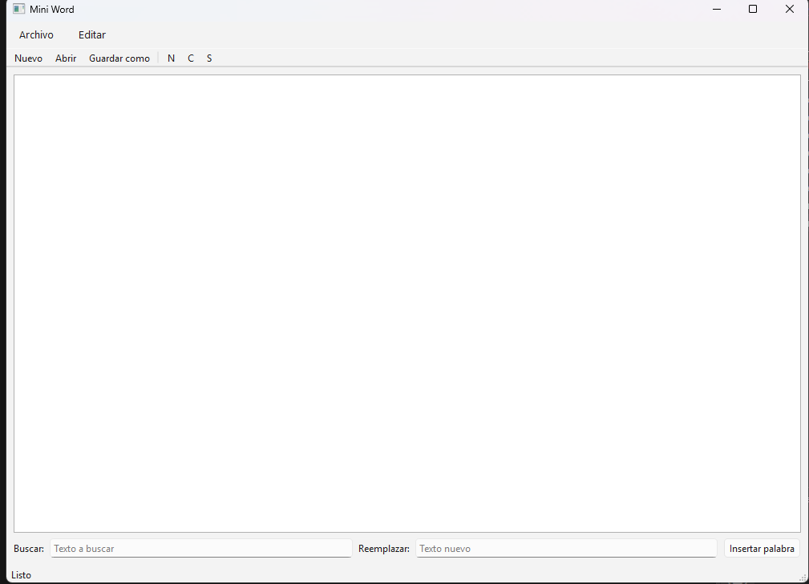
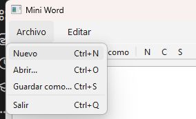
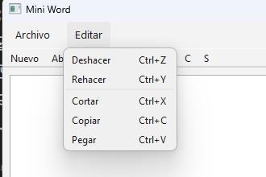
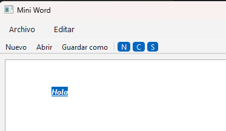
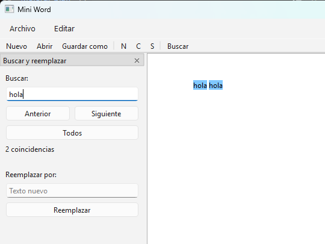
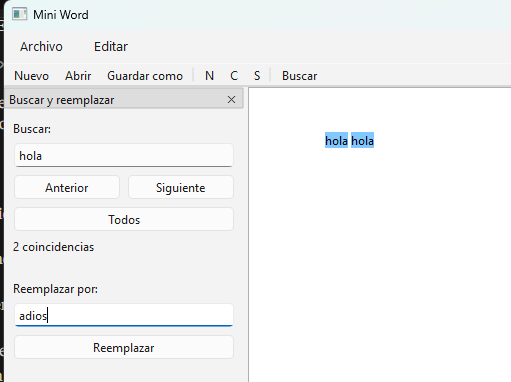
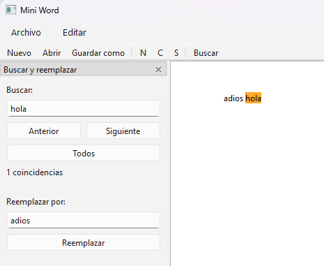

Mini Word

Editor de texto de escritorio hecho en Python con PySide6. Permite crear, abrir y guardar documentos, aplicar formato básico y buscar y reemplazar texto.

Requisitos
Python 3.10 o superior
pip
PySide6 (incluido en requirements.txt)
Sistema con entorno gráfico (Windows, macOS o Linux)
Instalación
bash
git clone <URL_DEL_REPOSITORIO>
cd <CARPETA_DEL_REPOSITORIO>
python -m venv .venv

Activar el entorno virtual:

bash
# Windows (PowerShell)
.venv\Scripts\Activate.ps1

# Linux / macOS
source .venv/bin/activate

Instalar las dependencias:

bash
pip install -r requirements.txt
Ejecución
bash
python main.py

En algunos sistemas el comando es python3 main.py.

Ventana principal

Funciones principales
Crear, abrir y guardar documentos en texto plano (.txt) o HTML (.html).
Deshacer, rehacer, cortar, copiar y pegar.
Negrita, cursiva y subrayado.
Búsqueda con resaltado de coincidencias y reemplazo de una en una.
Barra de estado con avisos.
El área de edición se estira al redimensionar la ventana.
Menús y atajos
Menú	Opción	Atajo
Archivo	Nuevo	Ctrl+N
Archivo	Abrir...	Ctrl+O
Archivo	Guardar como...	Ctrl+S
Archivo	Salir	Ctrl+Q
Editar	Deshacer	Ctrl+Z
Editar	Rehacer	Ctrl+Y
Editar	Cortar	Ctrl+X
Editar	Copiar	Ctrl+C
Editar	Pegar	Ctrl+V

La barra de herramientas tiene Nuevo, Abrir, Guardar como y los botones de formato, que no aparecen en los menús:

Botón	Función	Atajo
N	Negrita	Ctrl+B
C	Cursiva	Ctrl+I
S	Subrayado	Ctrl+U

Menú Archivo

Menú Editar

Formato de texto

Panel de búsqueda y reemplazo

El panel está oculto al arrancar. Se abre a la izquierda con el botón Buscar, desde Editar → Buscar o con Ctrl+F. Se cierra con la X del panel.

Elemento	Uso
Buscar	Texto que se quiere localizar.
Anterior	Selecciona la coincidencia anterior.
Siguiente	Selecciona la coincidencia siguiente (también con Enter).
Todos	Resalta todas las coincidencias.
Reemplazar por	Texto nuevo.
Reemplazar	Reemplaza la coincidencia seleccionada.
Reglas de búsqueda
No distingue mayúsculas de minúsculas: casa encuentra Casa y CASA.
Encuentra también partes de palabras: sol aparece dentro de girasol.
Las coincidencias se resaltan en azul mientras se escribe; la seleccionada aparece en naranja.
El panel muestra el número de coincidencias.
Anterior y Siguiente dan la vuelta al llegar al principio o al final del documento.
Al cerrar el panel desaparece el resaltado.
Reglas de reemplazo
Cada pulsación reemplaza solo una coincidencia y selecciona la siguiente.
Si no hay ninguna seleccionada, la primera pulsación solo la selecciona.
Los dos campos deben tener texto; no se puede reemplazar por nada para borrar.

Búsqueda

Antes del reemplazo

Después del reemplazo

